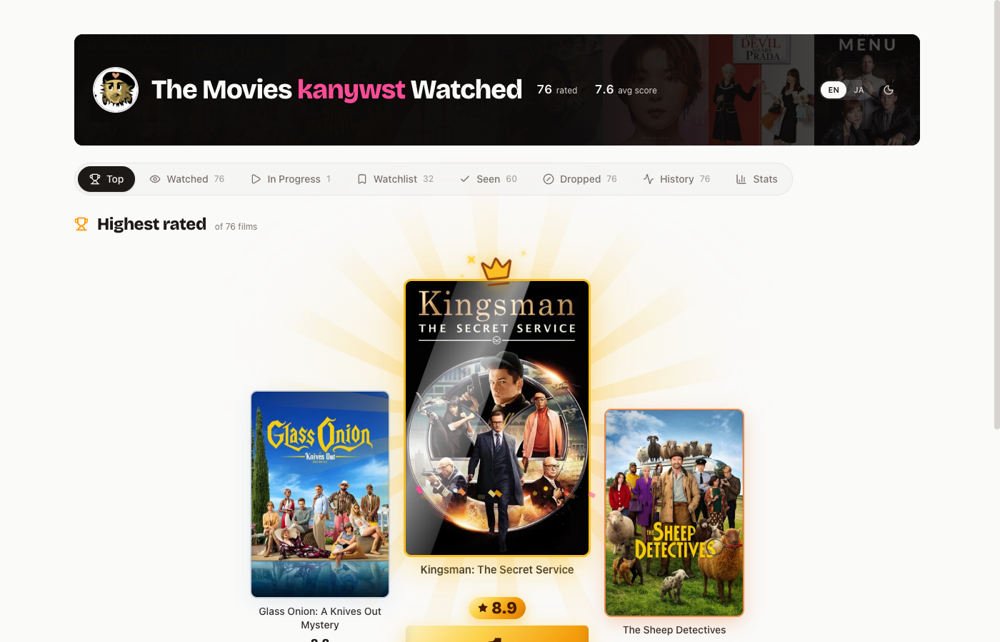
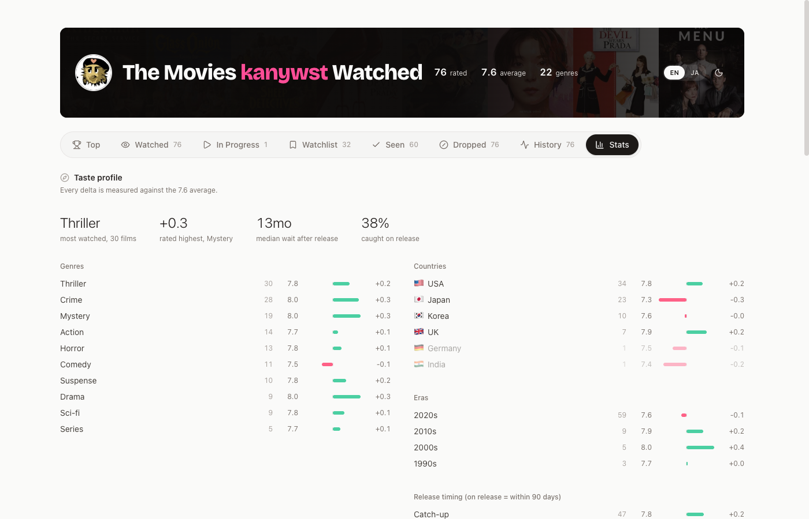

I keep a diary of every film I watch: score, where it streams, a one-line impression. It lives in a git repo as markdown, and a small React site reads it.

- Source: <https://github.com/kanywst/i-watched-movies>
- Live: <https://kanywst.github.io/i-watched-movies/>



## One file per film

Every entry is `movies/<slug>.md`. This is the current top of the diary, trimmed (the cover URL and EN/JA summaries are cut):

```yaml
---
title: 'Kingsman: The Secret Service'
title_ja: 'キングスマン'
published: true
tags:
  - 'Action'
  - 'Comedy'
national: 'UK'
streaming:
  - 'Disney+'
  - 'Prime Video'
checked: '2026-09'
release_date: '2015-01-29'
watch_date: '2026-09-23'
point: 8.9
---
```

Titles are stored in the original language (기생충, 無間道), with `title_en` and `title_ja` underneath when they differ. A build script walks `movies/`, writes one JSON file for the React app, plus an RSS feed, a sitemap and a static page per film so a shared link unfurls as that film.

Four flags split the files into five lists, and the precedence is fixed in `src/partition.ts`: dropped beats watching beats seen beats rated. Right now the 245 files break down like this (computed from the repo with that same function):

```text
watched (rated)  76
seen (unrated)   60
dropped          76
watchlist        32
in progress       1
```

Yes, I have given up on as many films as I have rated. Dropped gets its own tab and stays out of the stats, so it does not drag anything down.

## Adding a film is an issue

I almost never edit the files by hand. The repo has an "Add a movie" issue form. Submitting it starts `movie-from-issue.yml`, which parses the form, writes the file, runs lint, tests and build, opens a PR, squash-merges it and dispatches the Pages deploy. Progress shows up as labels on the issue: `status: queued`, `processing`, `pr-opened`, `merged`, or `failed` with a link to the run.

Filing an issue for a slug that already exists updates that entry, which is how a film moves from Watchlist to Watched. An empty field keeps the old value. Issue #1498 only bumped a watchlist rank, so its body is two fields:

```text
### Title

九龍城寨之圍城

### List

Watchlist

### Recommend rank

32
```

Running the same parser locally against that body:

```text
$ ISSUE_BODY="$(gh issue view 1498 --json body --jq .body)" ISSUE_NUMBER=1498 \
    node scripts/build-movie-from-issue.js
slug=twilight-of-the-warriors-walled-in
path=movies/twilight-of-the-warriors-walled-in.md
title=九龍城寨之圍城
list=Watchlist
watchlist=true
action=update
```

It found the existing file by title, merged, and wrote nothing new because the rank was already 32. The repo has 672 issues now. When I file a batch, they run in parallel, and a merge that loses the race to `main` retries up to five times with backoff.

## The Stats page argues with me



The Stats tab compares genre, country and era averages against my personal average. From the current data:

```text
baseline 7.65  median 7.85  spread 1.09
Crime     28 films  7.96  +0.31
Mystery   19 films  7.98  +0.33
Comedy    11 films  7.52  -0.13
Japan     23 films  7.35  -0.30
On release 29 films 7.38  -0.27
Catch-up   47 films 7.82  +0.17
```

Films I see within 90 days of release score lower than ones I catch up on later. A catch-up is usually something I already heard was good, so that gap measures picking as much as taste.

It also ranks the watchlist by the score the profile predicts. One rating broke that early. 新解釈・幕末伝 got a 1.0, and on its own it pulled Period to -3.04, which put Kingsman: The Golden Circle 42nd of 44 on the watchlist while the first Kingsman sat at the top. Now any score more than two standard deviations from the mean is capped before predicting. The averages on the page stay raw.

The page also backtests itself: predict every rated film from the other 75 and compare the miss against just guessing the average.

```text
model error     0.71
baseline error  0.71
```

That is 0.705 against 0.711, and the page prints "That is 1% closer." Genre and country explain almost nothing about how I score a film. The page prints both numbers live, so the ranking never claims more than it has.

"Top of the diary" replays the #1 spot in watch order. 28 Years Later held it for 313 days, until The Devil Wears Prada 2 took it for nine.

## Running it

```bash
npm install
npm run dev
```

I ran `npm test` on a fresh clone: 21 files, 316 tests, all pure logic, no component tests. The README has a short list of what to change if you want to fork it for your own log.
