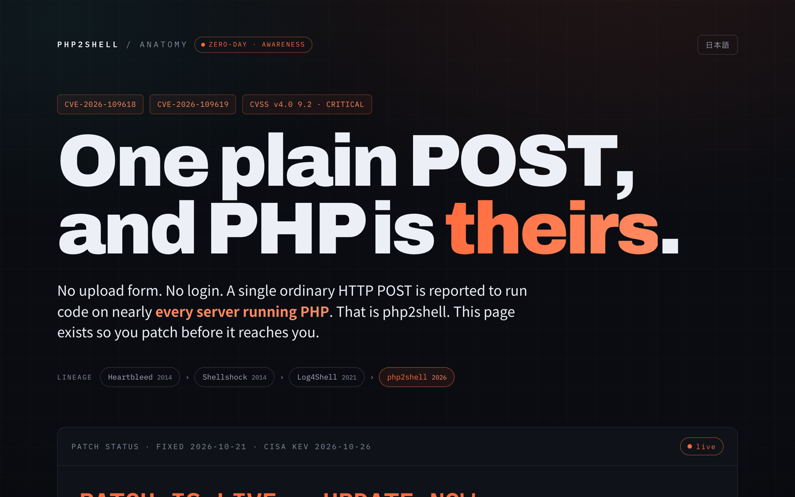
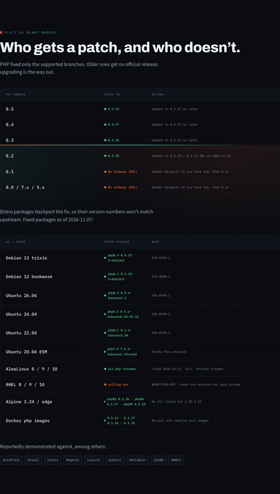
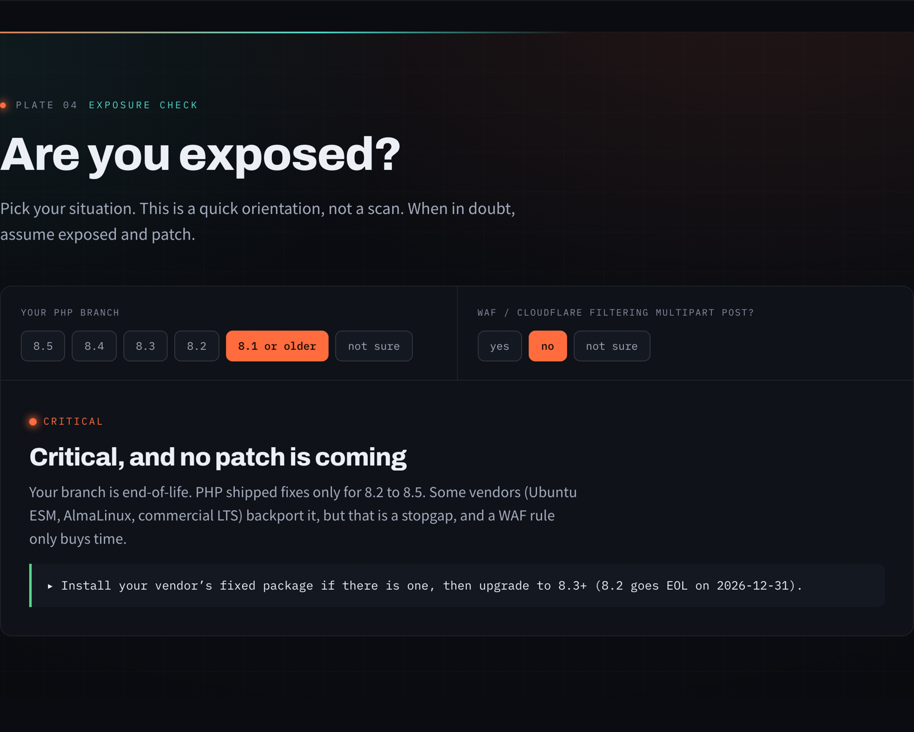

On 2026-10-20 php.net announced a critical security release for the next day at 14:00 UTC. Two bugs, both CVSS v4.0 9.2, unauthenticated RCE.

The people I wanted to reach were not going to read two long GitHub advisories. They needed three answers: am I affected, what version fixes it, what do I do tonight. So I made one page that answers those and nothing else. The first commit went in at 13:09 UTC on 10-21, under an hour before the release.

- Source: <https://github.com/0-draft/php2shell-anatomy>
- Live: <https://0-draft.github.io/php2shell-anatomy/> (English, with a Japanese toggle)



## It was a countdown first

Before the release, the status bar counted down to 14:00 UTC and told you to stage the update. At that instant it flips to `PATCH IS LIVE · UPDATE NOW`. The switch is one constant and one comparison in `src/logic.ts`:

```ts
/** The out-of-cycle PHP security release: 2026-10-21 14:00:00 UTC. */
export const PATCH_TARGET_MS = Date.UTC(2026, 9, 21, 14, 0, 0);

export function patchIsLive(now: number, target: number = PATCH_TARGET_MS): boolean {
  return now >= target;
}
```

Everything time-dependent on the page keys off that, including which verdict the exposure check gives you. Before the release, "8.3, no WAF" said "patch the moment it lands". After, it says the fix is out and CISA lists both CVEs as exploited.

## What is on it

The table I would want at 2 a.m.: fixed version per branch, then what your distro actually ships, because backported packages don't carry upstream version numbers. Ubuntu 24.04's fix is `8.3.6-0ubuntu0.24.04.13`, not 8.3.36.



The exposure check is two questions, your branch and whether something at the edge filters multipart POSTs. It's an orientation, not a scanner. Pick an EOL branch and it doesn't soften anything:



The rest: the mechanism in plain words, the timeline (leak, release, KEV on 10-26, the follow-up CVE-2026-115560 on 10-23), and a defense list that starts with "patch" and ends with "check the forgotten box". There's also a myth callout for `disable_functions`, which does nothing here. This is a memory-safety bug in the engine, not a shell function being called.

## How much mechanism to show

The page has no payloads, no request shapes, no reproduction steps. The "how it works" section stops at what PHP's own advisories say in their summaries:

- CVE-2026-109618 ([GHSA-w8hw-w9fx-j79w](https://github.com/php/php-src/security/advisories/GHSA-w8hw-w9fx-j79w)): PHP bails out of an out-of-memory error with `longjmp()` while request memory is half initialized, and shutdown then works on the broken state.
- CVE-2026-109619 ([GHSA-6wmf-4rv5-p3rp](https://github.com/php/php-src/security/advisories/GHSA-6wmf-4rv5-p3rp)): a long-lived worker keeps global state pointing into the previous request's freed memory, and the next request touches it before normal initialization resets it.

That is enough to explain why "we have no upload form" and "we disabled `system()`" are not answers. Anything more helps someone else more than it helps a defender.

## Checking a box

The fix is the release. The ini settings only matter if you can't update yet, and they are still worth knowing, because the patch does not change their defaults. This is a Homebrew PHP that already has the fix:

```text
$ php -v
PHP 8.5.12 (cli) (built: Oct 19 2026 17:02:46) (NTS)
$ php -r 'foreach (["session.upload_progress.enabled","fatal_error_backtraces","memory_limit"] as $k) printf("%-34s %s\n", $k, var_export(ini_get($k), true));'
session.upload_progress.enabled    '1'
fatal_error_backtraces             '1'
memory_limit                       '128M'
```

That's the CLI. Check under the SAPI you actually serve with (mod_php, FPM pool), since that's where the settings that count live.

## Not on the page yet

The site covers `session.upload_progress.enabled=0` as a partial mitigation. It doesn't yet cover two stopgaps from the advisories: `fatal_error_backtraces=0` on 8.5 (it removes the producer in the confirmed 109619 RCE) and `memory_limit=-1` for 109618, which PHP itself calls incomplete. Both are for people who can't update, and both need a worker restart.

Source and issues: <https://github.com/0-draft/php2shell-anatomy>
