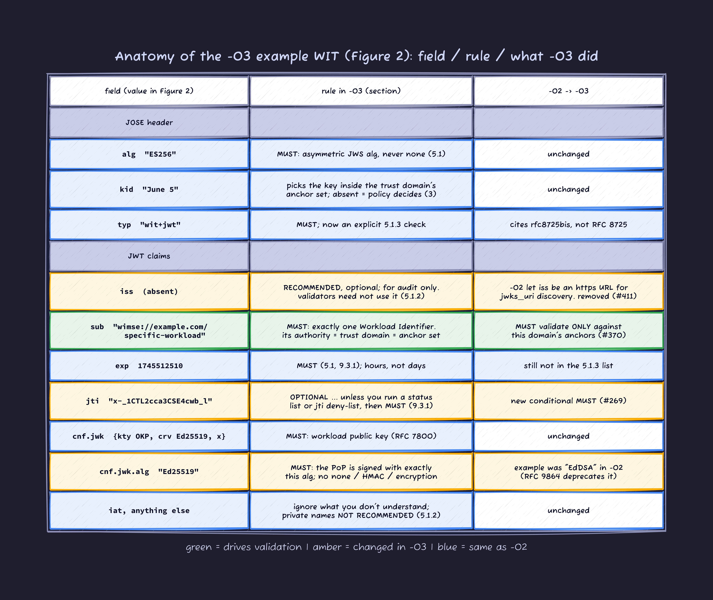
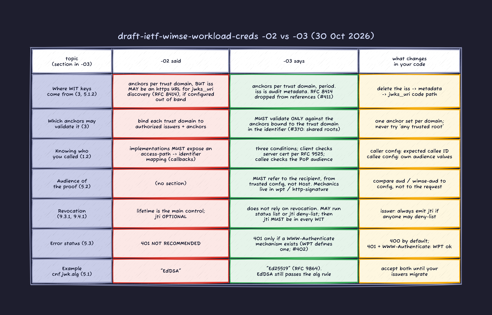

Revision -03 of [draft-ietf-wimse-workload-creds](https://datatracker.ietf.org/doc/draft-ietf-wimse-workload-creds/03/) came out on 30 October 2026, and the first thing I did was write a validator for its new Section 5.1.3, "Validating the WIT", and feed it the draft's own example token.

It passed. The token expired on 24 April 2025.

That isn't a bug in the example (examples go stale) or really in the checklist (it defers to the JWT best practices for the rest). It's a good picture of what -03 is: the first revision where a recipient gets an explicit list of WIMSE checks, and a list you still can't implement on its own.

My full notes, with the interop checklist, are on the [identity-deep-dive page for this draft](https://0-draft.github.io/identity-deep-dive/ietf-wimse/deep-dives/draft-ietf-wimse-workload-creds/). I covered the architecture draft back in March in [the WIMSE deep dive](https://dev.to/kanywst/wimse-workload-identity-in-multi-system-environments-deep-dive-standardizing-identity-5a12). This one only covers the credential draft and what -03 changed. I checked everything below against the -03 and -02 sources at the tags `draft-ietf-wimse-workload-creds-03` / `-02` in [ietf-wg-wimse/draft-ietf-wimse-s2s-protocol](https://github.com/ietf-wg-wimse/draft-ietf-wimse-s2s-protocol) and the datatracker iddiff, on 15 November 2026.

## Two credentials, one identifier

The draft defines exactly two things and says nothing about how you prove you hold their keys:

- **WIT** (Workload Identity Token): a JWS-signed JWT from the Identity Server. `sub` is the Workload Identifier, `cnf.jwk` is the workload's public key. It goes in a `Workload-Identity-Token` HTTP header, never in `Authorization`, and never as a bearer token.
- **WIC** (Workload Identity Certificate): an X.509 certificate whose Workload Identifier sits in exactly one URI SubjectAltName. It is for mutual TLS.

Proof of possession lives elsewhere: the Workload Proof Token ([draft-ietf-wimse-wpt-02](https://www.ietf.org/archive/id/draft-ietf-wimse-wpt-02.txt)), HTTP Message Signatures ([draft-ietf-wimse-http-signature-08](https://www.ietf.org/archive/id/draft-ietf-wimse-http-signature-08.txt)), and mutual TLS. -03 adds one sentence to the Introduction (issue #256): sending a WIT over TLS, or binding its proof to TLS session properties, does not make it a transport-layer credential. Mutual TLS uses the WIC.

Section 4 keeps the one-identifier rule for both: "Each WIMSE credential carries exactly one Workload Identifier". For a WIC, a second URI SAN carrying a Workload Identifier is a MUST NOT (Section 6.1). DNSName SANs are still RECOMMENDED for server certificates, for clients that validate by host name.

## The WIT, field by field

Here is the example from Section 5.1 decoded. The header is `{"alg":"ES256","kid":"June 5","typ":"wit+jwt"}` and the claims are:

```json
{
  "cnf": {
    "jwk": {
      "alg": "Ed25519",
      "crv": "Ed25519",
      "kty": "OKP",
      "x": "1CXXvflN_LVVsIsYXsUvB03JmlGWeCHqQVuouCF92bg"
    }
  },
  "exp": 1745512510,
  "iat": 1745508910,
  "jti": "x-_1CTL2cca3CSE4cwb_l",
  "sub": "wimse://example.com/specific-workload"
}
```



Three fields matter more than the rest.

**`sub`** selects the keys. Its authority (`example.com`) is the trust domain, and the trust domain picks the anchor set. Nothing else in the token gets a say. The validator never asks "who signed this?". It asks whether the signature came from one of the keys this trust domain was configured with.

**`cnf.jwk.alg`** pins the proof algorithm: "The presented proof MUST be produced with the algorithm specified in this field". `none`, symmetric and encryption algorithms are banned, and general-purpose implementations MUST support `ES256`. The WPT draft echoes it: the WPT header `alg` "MUST match the `alg` value of the `jwk` in the `cnf` claim of the WIT". In -03 the example moved from `EdDSA` to `Ed25519`, because [RFC 9864](https://www.rfc-editor.org/rfc/rfc9864) registered `Ed25519` as a fully specified algorithm and marked `EdDSA` Deprecated. The normative rule only says "Allowed values are listed in the IANA ... registry", and a Deprecated entry is still listed, so `EdDSA` stays legal. If your verifier only knows one of the two names, it will reject keys from issuers that use the other.

**`iss`** is the one that changed the most, and the change is that it now does almost nothing. More on that below.

## What -03 changed

Appendix A.1 lists 23 changes. Most are editorial. These seven change code:



### Trust anchors: no more iss-based discovery

In -02, Section 3 already said consumers MUST bind each trust domain to authorized issuers and anchors out of band, and that `iss` MUST NOT be used to look up keys from information carried only in the token. But -02 then had a whole subsection, 5.1.3 "A note on `iss` claim and key distribution", that let implementations put an `https` URL in `iss` "to facilitate key distribution via mechanisms like the `jwks_uri` from RFC 8414", as long as that was configured out of band.

-03 deletes that subsection (issue #411, "Simplify iss wordings"), drops RFC 8414 from the references, and puts the validation checklist where it used to be. `iss` is RECOMMENDED "for the auditing and operational uses", and "Validators are not required to use `iss`". The reason moved to Section 9.1:

> a validator that obtains key material from the credential itself, for example by resolving the `iss` claim of a WIT to a key set, would accept credentials from any entity able to operate an issuer.

The other change in Section 3 came from issue #370, "Multiple trust domains sharing or overlapping trust roots". -03 adds:

> A credential MUST be validated only against the anchors bound to the trust domain named in its Workload Identifier.

This is the line that matters if you run several trust domains off one CA. A WIC that chains to a shared root but carries `spiffe://payments.example/...` must be validated against the anchors configured for `payments.example`. "Chains to something I trust" is not enough. Section 9.4 (9.3 in -02) already said the certificate MUST be rejected if the identifier is outside the trust domain of the anchor used. -03 states it once for both credentials.

### The validation procedure

Issue #290 was blunt: "The creds draft seems to me missing guidance for validating the WIT. Both the WIT and HTTP signatures drafts will need to reference it." Section 5.1.3 in -03 is the answer. The recipient MUST ensure:

1. The token is a single well-formed JWT using JWS compact serialization.
2. `sub` is present and is a single Workload Identifier; its trust domain selects the anchors.
3. `typ` conveys `wit+jwt`.
4. The JWS signature is valid under those anchors (Section 3: `kid` picks the key; without `kid`, deployment policy must make the choice unambiguous).
5. `cnf` contains a `jwk` with an `alg` member, as specified in Section 5.1.
6. Unknown claims are ignored.

Before any of that, the whole thing "follows RFC 7515 and the JWT best practices in [rfc8725bis]". That sentence is the one carrying `exp`. It isn't in the list, but Section 5.1 makes `exp` mandatory, Section 9.3.1 says "The WIT MUST have a limited lifetime", and Section 5.3 names "an expired validity time window" as a validation failure. You have to enforce it. The checklist won't remind you.


The bottom half of that flow isn't in Section 5.1.3, and -03 is explicit about why it's needed. New Section 9.2:

> Validating a peer's credential against the trust anchors for a trust domain establishes that the peer belongs to that trust domain, but does not by itself establish which workload the peer represents.

And: "Proof of possession does not mitigate this vulnerability." Passing checks 1 to 6 plus a valid PoP proves that the caller is some workload in `example.com` holding the key in its WIT. Whether it's the workload you wanted is a separate comparison.

### Audience and "who did I call?"

-02 handled that comparison with a requirement nobody could implement uniformly: "Implementations MUST allow for defining this mapping between the workload's access path and the workload identifier (e.g., through callback functions)." -03 removes it (issues #173 and #175) and states three conditions instead:

- Each workload must know its own identifier.
- A callee must be able to verify that a request is intended for it.
- A caller that authenticates the callee must know the identifier it expects the callee to present.

At the transport layer, the client checks the server certificate against that expected identifier per [RFC 9525](https://www.rfc-editor.org/rfc/rfc9525). At the application layer there's a new Section 5.2:

> A recipient MUST verify that the audience refers to it, using trusted configuration rather than request fields such as `Host`, because intermediaries may rewrite the request URI.

The audience lives in the proof, not the WIT. In WPT it's `aud`, which "SHOULD contain the HTTP target URI" but may be "a deployment-specific value" after rewriting. In HTTP signatures it's the mandatory `wimse-aud` parameter, compared "using the Simple String Comparison method" against "one of the audience values in its trusted configuration". The http-signature draft deliberately leaves `@authority` out of the signature, because proxies rewrite it. The -03 rule tells the recipient to look at its own config, not at the request, and both companion drafts already do that.

### Revocation, 401, keys

- Section 9.3.1: "This document does not define a revocation mechanism for WITs and does not rely on one". You MAY run a Token Status List or a `jti` deny-list, and if you do, `jti` MUST be in every WIT. In Section 5.1 `jti` is still OPTIONAL, so a validator can't tell from the token whether the issuer is in that mode. WICs get the same stance: short lifetimes, no reliance on CRL or OCSP (9.4.1).
- Section 5.3: -02 said 401 was NOT RECOMMENDED. -03 allows it "when an acceptable HTTP authentication mechanism exists that can be returned with the WWW-Authenticate HTTP header". Issue #402 gives the reason: "WPT uses 401". Since August, WPT rides in `Authorization: WPT <jwt>`, and wpt-02's Error Conditions answer WPT failures with a 401 and `WWW-Authenticate: WPT`.
- Section 9.5: keys SHOULD be regenerated per credential "unless the key is sufficiently protected, e.g., non-exportable and hardware-bound", and "Verifiers must not infer such stronger properties from the WIT or WIC alone."
- Section 9.2: deprovisioning a workload doesn't invalidate its existing WITs or WICs. They work until `exp` plus clock skew.

## Hands-on: run the checklist against the spec

[`validate_wit.py`](https://github.com/0-draft/dev.to/tree/main/articles/assets/wimse-workload-creds-03) implements the six checks in order, with a preconfigured map from trust domain to anchors. `example.com` gets the Identity Server key published in Section 5.1. `lab.example` gets a key I generate so I can sign mutated tokens. It never dereferences `iss`. The only dependency is `cryptography`. The second column turns on the `exp` check that 5.1.3 leaves to the JWT best practices.

```bash
cd articles/assets/wimse-workload-creds-03 && ./run.sh
```

```text
case                                 5.1.3 only                           5.1.3 + exp
spec Figure 2 WIT                    ACCEPT                               reject: expired 2025-04-24
lab WIT, fresh                       ACCEPT                               ACCEPT
typ: JWT                             reject: typ is 'JWT'                 reject: typ is 'JWT'
sub as array of two URIs             reject: sub not one identifier       reject: sub not one identifier
sub in unconfigured domain           reject: no anchors for evil.example  reject: no anchors for evil.example
iss -> attacker JWKS, attacker key   reject: kid 'evil' unknown           reject: kid 'evil' unknown
right kid, attacker key              reject: bad signature                reject: bad signature
cnf.jwk without alg                  reject: no cnf.jwk.alg               reject: no cnf.jwk.alg
cnf.jwk.alg: HS256                   reject: cnf.jwk.alg HS256            reject: cnf.jwk.alg HS256
cnf.jwk.alg: EdDSA (deprecated)      ACCEPT                               ACCEPT
iss: https://other-issuer.example    ACCEPT                               ACCEPT
unknown claim example.com/team       ACCEPT                               ACCEPT
no iss, no jti                       ACCEPT                               ACCEPT
expired an hour ago                  ACCEPT                               reject: expired 2026-11-14
four segments                        reject: not one compact JWS          reject: not one compact JWS
```

What I learned from it:

- The re-signed -03 example verifies under the published `June 5` key. The token is consistent. It's just old.
- A literal 5.1.3 implementation accepts a token that expired an hour ago. Treat `exp` as a seventh check.
- `iss: https://other-issuer.example` on a correctly signed `lab.example` token passes. Section 3 requires "a known, preconfigured issuer" per trust domain, but nothing says to compare a present `iss` against it. I'd log the mismatch. Rejecting it is a local policy choice, not something the draft asks for.
- The attacker-JWKS case fails at key selection. There is no code path that could fetch a URL, and that is the point of #411.
- `EdDSA` passes because it's still in the registry. Decide on purpose whether you accept it.

## Loose ends

**Two companion drafts cite a section that doesn't exist.** wpt-02's WPT validation rules say "the recipient MUST first validate the WIT as specified in Section 5.1.4 of [I-D.ietf-wimse-workload-creds]". http-signature-08 says the same in two places. -03 has no 5.1.4: the TOC goes 5.1.1 header, 5.1.2 additional claims, 5.1.3 validating. -02 had no 5.1.4 either. http-signature-08 also sends readers to "Sec. 1.2" for the deployment architecture, which was right for -02 and is now 1.1, because -03 deleted "Use In Other Protocols". These are small, but a validator that follows the references lands on nothing.

**Membership versus identity is still deployment work.** Section 9.2 names the gap and Section 1.2 lists the conditions, but how a caller learns the identifier it expects, and how a callee learns its own audience values, are left to configuration. That is a reasonable call for a credential spec. Still, it's the part most likely to be skipped in practice, because skipping it doesn't break anything until a sibling workload in the same trust domain calls you.

**The shorter Section 4.** -02 had a paragraph for deployments with "several labels for the same runtime (for example a stable service identity and a specific instance)": put the access-decision identity in the credential and never add a second identifier for correlation. -03 cuts it (#395) and keeps "exactly one". Instances that share an identifier can be told apart by `jti`, and Section 9.2 warns that "the identifier alone cannot distinguish them for authorization or auditing."

**Section 1.2 softened one MUST.** -02 said implementations "MUST enforce the URI requirements" of the identifier draft. -03 says they "are expected to conform". If your identifier parsing was gated on that MUST, it now rests on draft-ietf-wimse-identifier alone.

The chair, Justin Richer, asked the list on 30 October to "flag anything that you'd consider a substantive cha[n]ge that would require additional WG discussion", because this is a core document. When I checked the thread on 15 November it still had no replies. If you implement WITs, the 5.1.4 references and the missing `exp` line are both easy things to raise there.

## Checklist

For a validator:

- Map trust domain to anchors out of band. Unknown trust domain means reject, with no discovery fallback.
- Run the six 5.1.3 checks, plus `exp` with an explicit skew, plus your `header.alg` allowlist per trust domain.
- Never fetch anything based on `iss`.
- Verify that the proof's `alg` equals `cnf.jwk.alg` and that its audience matches your configured values, not `Host`.
- Authorize on the full identifier, scoped to its trust domain (Section 7), and compare it to the identifier you expected.
- Return 400 by default. Use 401 only with `WWW-Authenticate: WPT` or another real scheme.

For an issuer:

- Exactly one identifier in `sub` / one URI SAN.
- Always set `cnf.jwk.alg`. Prefer `Ed25519` over `EdDSA` in new keys, `ES256` for maximum reach.
- Emit `jti` if anyone downstream might run a deny-list.
- Lifetimes in hours. Fresh key per credential unless it's non-exportable and hardware-bound.
