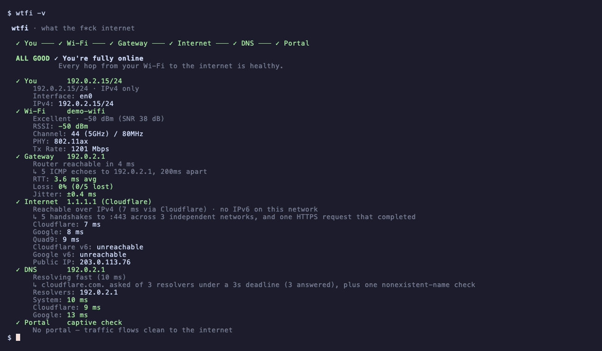
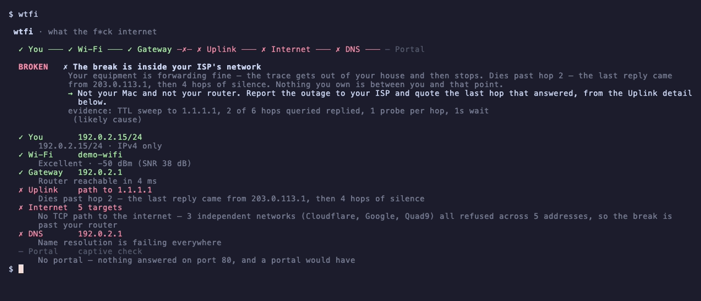

The Wi-Fi icon shows full bars. The browser says "Offline". Then I am in a terminal running `ping` and `traceroute`, trying to line the answers up in my head.

My first attempt at fixing that was [`wtfi`](https://github.com/kanywst/wtfi), a Go CLI for macOS that printed every check as a flat list. It was still ten lines I had to correlate myself. So I rewrote it in Rust as wtfi2: it draws the connection as a chain, probes every hop at once, and answers in one line.

- Source: <https://github.com/kanywst/wtfi2>
- Install: `brew install kanywst/tap/wtfi2` or `cargo install wtfi2` (the command is `wtfi`)
- Runs on macOS and Linux, no sudo


## One line, then the evidence

`wtfi` sweeps Host, Wi-Fi, Gateway, Internet, DNS and captive portal concurrently, then walks the finished chain for the first hop that failed. Everything after that hop is collateral and does not get a verdict of its own.

A DNS-only outage, from the hidden `--demo` flag (a `--features demo` build that replays scripted sweeps on RFC 5737 addresses, so nothing here is my network). These are the first lines of the report:

```text
  ✓ You ─── ✓ Wi-Fi ─── ✓ Gateway ─── ✓ Internet ─✗─ ✗ DNS ─── – Portal

  BROKEN   ✗ DNS resolution is failing
```

A cause line follows, then the fix and how it was measured:

```text
            → Switch resolvers to 1.1.1.1 / 8.8.8.8, or flush the DNS cache.
            evidence: cloudflare.com. asked of 3 resolvers under a 3s deadline (2 answered), plus one nonexistent-name check
             (likely cause)
```

Every verdict carries that `evidence` line and a confidence. One dropped packet and a five-probe burst should not read the same. `wtfi -v` shows the metrics behind each hop:



## "Your ISP is down" needs a hop number

When the gateway answers and nothing past it does, wtfi adds an `Uplink` node and runs a bounded ICMP TTL sweep. A healthy run never pays for it. Where the replies stop decides the verdict: at the first step outside the house it blames the modem, ONU or WAN cable; deeper in, it blames the provider and names the last address that answered so you have something to quote on the support call.



If a full-tunnel VPN owns the default route, the same trace went through the tunnel, and the verdict says so instead of sending you to your ISP.

## Not measured is not broken

A lot of the fixes in the git log restore one rule: a probe that could not run is unknown, not a failure. One example is #72. On corporate Wi-Fi and client-isolated APs, the gateway drops every ICMP echo and TCP probe. wtfi used to say "Your router isn't responding" while the WAN probe was going out through that same router. Now a silent gateway with a reachable WAN is graded ok and marked `Probes: ignored (filtered)`.

The exit code follows the same rule. `0` is fine, `1` degraded, `2` broken, `3` unsupported OS, and `4` means the OS tools wtfi reads the network through would not run at all. A script should retry on `4`, not page someone.

```text
$ wtfi --demo=dns --json | jq '{status, first_break, verdict: (.verdict | {headline, confidence, source, fix})}'
{
  "status": "fail",
  "first_break": "dns",
  "verdict": {
    "headline": "DNS resolution is failing",
    "confidence": "likely",
    "source": "dns",
    "fix": "Switch resolvers to 1.1.1.1 / 8.8.8.8, or flush the DNS cache."
  }
}
$ echo $?
2
```

Each probe is capped at 8 seconds and the whole sweep at 20 (`--timeout` changes that), so a hung resolver cannot hang the CLI.

## The outage you only notice afterwards

Wi-Fi tends to break while I am in the middle of something, and by the time I sit down to look at it, it works again. So wtfi can record:

```bash
wtfi --record --every 30s   # headless, and faster while the network is broken
wtfi --history              # the last 20 sweeps, one line each
wtfi --bundle 2h | pbcopy   # Markdown for an AI agent
```

`contrib/` has a launchd plist and a systemd user unit to keep the recorder running at login.

`--bundle` groups the sweeps into episodes and adds latency percentiles, a timeline that marks Wi-Fi channel changes (roams, band steering), the full JSON sweeps around each change, and the OS's own network log around each episode (`log show` on macOS, `journalctl` on Linux). It ends with a request for a root-cause analysis. SSIDs, MACs, public IPv4 addresses and this machine's IPv6 addresses are masked by default. The episode table from five recorded demo sweeps:

```text
## Episodes

| Start | Duration | Sweeps | Worst | First break | Headline |
| --- | --- | --- | --- | --- | --- |
| 2026-11-14 21:31:25Z | 11s | 3 | fail | dns | DNS resolution is failing |
```

If you would rather let the agent pull only what it needs, `wtfi --mcp` serves the same history over stdio:

```bash
claude mcp add wtfi -- wtfi --mcp
```

```text
["list_episodes","get_timeline","get_sweeps","get_os_log","get_bundle","diagnose_now"]
```

That is the `tools/list` reply from the server.

## Platforms

On macOS, link telemetry comes from CoreWLAN, so RSSI, noise, channel and PHY arrive instantly without `system_profiler`. Since macOS 14 the SSID and BSSID are redacted for apps without Location permission, so an unsigned build shows them as hidden. Nothing that matters for the diagnosis is lost. A signed `.app` with Location access is on the roadmap.

On Linux it reads the same facts without root through `ip -j`, `iw` and `resolv.conf`, falling back to `/proc` when those tools are missing. There is also a Nix flake: `nix run github:kanywst/wtfi2 -- -w`.

Source and issues: <https://github.com/kanywst/wtfi2>
