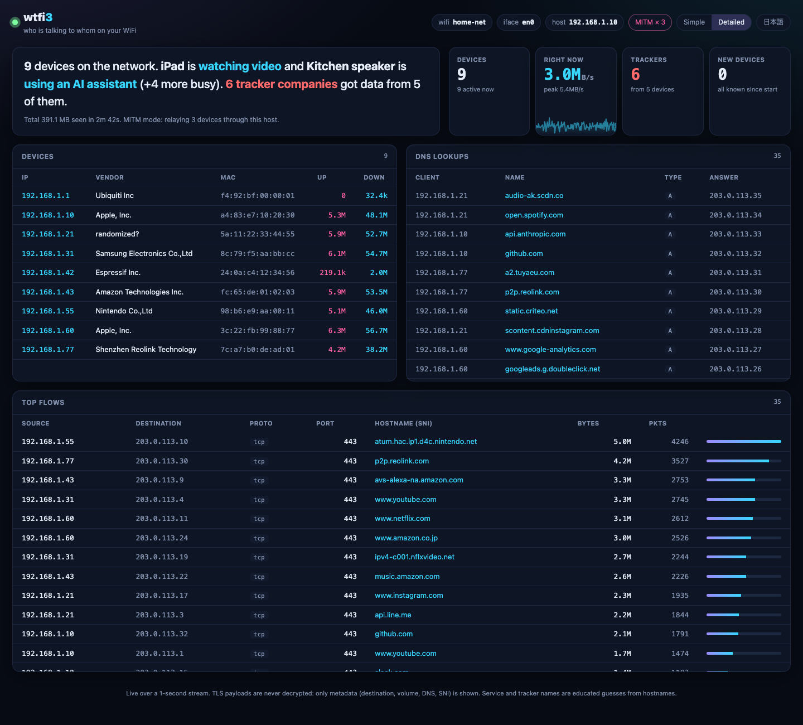

A router's admin page lists the devices on the network and stops there. I wanted the other half: who each one is talking to. Wireshark answers that, but I wanted something I could leave open in a tab.

wtfi3 is one Go binary. Point it at an interface, open `http://localhost:8080`, and it draws which device talks to which service, which of those are trackers, and how many bytes are moving right now.

- Source: <https://github.com/kanywst/wtfi3>
- Install: `brew install kanywst/tap/wtfi3` or `go build -o wtfi3 ./cmd/wtfi3` (needs libpcap)


All screenshots here come from `make demo`, which serves the dashboard on synthetic household traffic. None of it is my network.

## Metadata, not payloads

Nothing is decrypted. What wtfi3 reads is what is already in the clear:

- IP and MAC addresses, with the vendor looked up in an embedded copy of the IEEE OUI list
- bytes and packets per flow (source, destination, protocol, port)
- DNS responses: which client asked for which name, and the answer
- the SNI hostname in a TLS ClientHello on port 443 or 8443

The SNI parser is about a hundred lines in `internal/tlsmeta/sni.go`: walk the record header, skip the random, session id, cipher suites and compression methods, then look for extension `0x00`. That is enough to know a device is on `www.youtube.com`, not which video.

## Trying it without root

`-r` replays a pcap and needs no root. The repo has a generator for a six-packet capture: a phone and a TV doing a TLS ClientHello and a DNS lookup each.

```bash
go run hack/gensample.go sample.pcap
./wtfi3 -i nosuch0 -r sample.pcap -listen 127.0.0.1:18080
curl -s 127.0.0.1:18080/api/state
```

I gave it a nonexistent interface on purpose so it would not read my real one. The log says so:

```text
WARN offline mode: interface unavailable, LAN attribution limited iface=nosuch0
INFO dashboard serving addr=127.0.0.1:18080 spoof=false
INFO finished replay; dashboard still serving (Ctrl-C to quit) addr=127.0.0.1:18080
```

`/api/state`, trimmed to the interesting fields:

```text
"flows": [
  {"src": "192.168.0.20", "dst": "93.184.216.34", "proto": "tcp", "dst_port": 443,
   "bytes": 1584, "packets": 2, "sni": "www.youtube.com"},
  {"src": "192.168.0.31", "dst": "140.82.121.4", "proto": "tcp", "dst_port": 443,
   "bytes": 984, "packets": 2, "sni": "api.netflix.com"},
  ...
],
"dns": [
  {"client": "192.168.0.31", "name": "api.netflix.com", "type": "A", "answer": "44.242.61.10"},
  {"client": "192.168.0.20", "name": "www.youtube.com", "type": "A", "answer": "142.250.196.142"}
],
"devices": null
```

`devices` is empty because a device is a host inside one of the capture interface's on-link prefixes, and with no interface there are none. Flows and DNS do not depend on that. On a live interface the same packets fill in the device rows.

The browser gets the same JSON over Server-Sent Events, once a second, from `/api/stream`.

## Naming the trackers

Raw flow tables tell you `app-measurement.com`. The Simple view tells you `Google Analytics`. The dictionary is 26 regexes in `internal/web/index.html`, covering ad networks, analytics, attribution SDKs, crash reporters, and IoT and smart TV telemetry (`tuyaus.com` is `Tuya cloud`, `samsungacr.com` is `Samsung TV telemetry`). Every pattern is anchored at a label boundary, and there is deliberately no catch-all for `telemetry` or `metrics`, because that cannot tell a third party from the device vendor's own servers.

Each device card gets a tracker badge: green for 0, amber for 1 to 4, red for 5 or more. A device that joins more than 20 seconds after startup is flagged `NEW` for 90 seconds. Everything already there at startup is the baseline.

The Detailed view drops the interpretation and shows the tables:



## Seeing other devices

On a switched network your machine only receives its own unicast plus broadcast and multicast. Passive mode shows exactly that. To see the TV's flows you have to sit between it and the gateway, so wtfi3 has an ARP-spoof mode:

```bash
sudo ./wtfi3 -i en0 -spoof -i-own-this-network
```

`-spoof` alone refuses to run. With both flags it ARP-scans the subnet every 30 seconds, poisons each target and the gateway every 2 seconds, turns on IP forwarding, and on exit sends the real MACs back three times to restore the caches. The forwarding toggle is `sysctl -w net.inet.ip.forwarding`, the macOS name.

A relayed packet crosses the capture interface twice (target to me, me to gateway), so in spoof mode only the leg addressed to my MAC is counted. Otherwise every byte would show up double.

This is an active man-in-the-middle. Run it on a network you own.

## The dashboard leaks too

The dashboard shows every device's DNS names and destinations with no password, so it binds to `127.0.0.1` by default. Loopback alone is not enough: a web page in the same browser can reach it through DNS rebinding. So while it is bound to loopback, any request whose `Host` is not `localhost`, `127.0.0.1` or `::1` gets a 403:

```text
$ curl -s -o /dev/null -w '%{http_code}\n' -H 'Host: evil.example' 127.0.0.1:18080/api/state
403
```

`-listen 0.0.0.0:8080` still works and logs a warning. An SSH tunnel is the better way to open it from another machine.

Source and issues: <https://github.com/kanywst/wtfi3>
